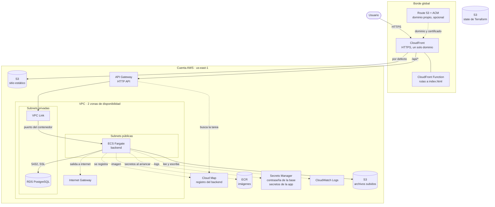

# Arquitectura

Un entorno es una aplicación web completa en una cuenta de AWS: sitio estático, backend en contenedores, base de datos PostgreSQL y almacenamiento de archivos, detrás de un único dominio con HTTPS.

## Vista general



El bucket del state de Terraform está aparte: lo crea `bootstrap`, una vez por cuenta, y lo comparten todos los entornos.

## Capas

| Capa | Servicio | Qué hace |
|---|---|---|
| Entrada | CloudFront | Único punto de entrada, con HTTPS. Envía `/api/*` a API Gateway y el resto al bucket del sitio |
| Entrada | CloudFront Function | Traduce `/ruta/` y `/ruta` a `/ruta/index.html`, que es como se guarda un export estático |
| Entrada | Route 53 y ACM | Opcionales. Dominio propio y su certificado |
| Sitio | S3 | Archivos del frontend. Privado: solo lo lee la distribución |
| API | API Gateway (HTTP API) | Dirección estable del backend. Cobra por petición |
| API | VPC Link | Interfaces de red de API Gateway dentro de la VPC, en las subnets privadas |
| API | Cloud Map | Registro donde cada tarea anota su IP y puerto al arrancar; API Gateway lo consulta para saber a quién enviar la petición |
| Backend | ECS Fargate | Contenedor del backend. Su imagen viene de ECR |
| Backend | Secrets Manager | Contraseña de la base (administrada por RDS) y secretos de la aplicación (creados vacíos, cargados a mano) |
| Backend | CloudWatch Logs | Logs del contenedor y logs de acceso de API Gateway |
| Datos | RDS PostgreSQL | Base de datos, en subnets privadas, sin acceso desde internet |
| Datos | S3 | Archivos que suben los usuarios. Privado: solo el rol de la tarea tiene acceso |
| Red | VPC | Subnets públicas y privadas en dos zonas. Sin NAT Gateway en el perfil mínimo |

## Recorrido de una petición

1. El usuario abre el dominio por HTTPS.
2. CloudFront decide según la ruta:
   - `/api/*` va a API Gateway, sin caché, con la ruta intacta.
   - Todo lo demás sale del bucket del sitio, con caché, pasando por la CloudFront Function.
3. API Gateway consulta Cloud Map, encuentra la IP y el puerto de la tarea, y le envía la petición por el VPC Link.
4. El backend responde, consultando la base por el puerto 5432 con SSL.

Las tareas de Fargate cambian de IP en cada despliegue. Nadie usa esa IP directamente: Cloud Map la mantiene al día y las reglas de red se definen entre security groups, no entre direcciones.

## Recorrido de un archivo subido

Con URL prefirmadas, que es lo recomendado:

1. El navegador pide al backend permiso para subir un archivo.
2. El backend genera una URL prefirmada de S3, válida por pocos minutos.
3. El navegador sube el archivo directo al bucket con esa URL.

El archivo no pasa por el contenedor y no aplica el límite de 10 MB por petición de API Gateway. Una aplicación que recibe los archivos en el backend y los escribe al bucket también funciona, dentro de ese límite.

## Qué recibe el backend al arrancar

| Origen | Contenido |
|---|---|
| Variables de entorno | Dirección, puerto y nombre de la base; nombre del bucket de archivos; variables propias de la aplicación |
| Secretos | Usuario y contraseña de la base; secretos propios de la aplicación |
| Rol de la tarea | Permiso sobre el bucket de archivos, sin llaves de AWS |

Los nombres de las variables los elige cada aplicación. Ver [docs/stacks/web-app/interface.md](../stacks/web-app/interface.md).

## Quién puede hablar con quién

| Origen | Destino | Puerto | Cómo se restringe |
|---|---|---|---|
| Internet | CloudFront | 443 | Público |
| CloudFront | S3 del sitio | 443 | Origin Access Control: el bucket solo acepta a esta distribución |
| CloudFront | API Gateway | 443 | HTTPS. El endpoint de API Gateway también es alcanzable directamente |
| VPC Link | Tarea de ECS | Puerto del contenedor | El security group de la tarea solo acepta al del VPC Link |
| Tarea de ECS | RDS | 5432 | El security group de la base solo acepta al de la tarea |
| Tarea de ECS | S3 de archivos | 443 | Solo el rol de la tarea tiene permisos sobre el bucket |
| Navegador | S3 de archivos | 443 | Solo con URL prefirmada vigente; CORS limitado al dominio del sitio |
| ECS | Secrets Manager | 443 | Solo el rol de ejecución, y solo sobre los secretos de esta tarea |
| Internet | RDS | — | Sin acceso: subnets privadas sin ruta a internet |

Todos los buckets tienen el acceso público bloqueado y rechazan conexiones sin HTTPS.

## Componentes y módulo que los crea

| Componente | Módulo |
|---|---|
| Bucket de state | `bootstrap` |
| VPC, subnets, rutas, NAT opcional | `network` |
| Bucket del sitio, CloudFront, CloudFront Function, registros del dominio | `static-site` |
| Repositorio de imágenes | `ecr` |
| Cluster, servicio, tarea, roles, security group, Cloud Map, logs | `ecs-service` |
| API HTTP, VPC Link, logs de acceso | `api-gateway` |
| Base de datos, su security group y la rotación de la contraseña | `rds-postgres` |
| Bucket de archivos y su política de acceso | `uploads-bucket` |
| Secretos de la aplicación | `app-secrets` |
| Certificado del dominio propio | `acm-certificate` |
| Zona del dominio propio | stack `dns-zone`, o creada a mano en la consola |

El stack `web-app` compone todos los módulos.

## Nombres

Cada recurso se llama `<servicio>-<producto>-<propósito>-<entorno>`. Con el producto `ejemplo` en `dev`:

| Recurso | Nombre |
|---|---|
| Cluster y servicio | `ecs-ejemplo-dev`, `ecs-ejemplo-api-dev` |
| Base de datos | `rds-ejemplo-postgres-dev` |
| Buckets | `s3-ejemplo-static-site-dev-<account_id>`, `s3-ejemplo-upload-files-dev-<account_id>` |
| API | `apigw-ejemplo-api-dev` |
| Secretos de la app | `secret-ejemplo-<nombre>-dev` |

Tabla completa en [naming.md](naming.md).

## Entornos

Cada producto tiene sus entornos (`dev`, `prod`) en la cuenta de su cliente. Cada uno es una copia completa e independiente: su propia VPC, frontend, backend, base de datos, bucket de archivos y secretos. Solo comparten el bucket de state, donde cada uno tiene su ruta.

```
Cuenta AWS del cliente
├── Bucket de state
│   ├── <producto>/dev/terraform.tfstate
│   └── <producto>/prod/terraform.tfstate
├── Entorno dev   (VPC 10.20.0.0/16)
└── Entorno prod  (VPC 10.21.0.0/16)
```

El tamaño de cada entorno lo define un perfil (`minimal` o `production`): NAT Gateway, cantidad de tareas, Multi-AZ, protecciones. La arquitectura es la misma. Ver [environments.md](environments.md) y los costos en [costs.md](costs.md).
