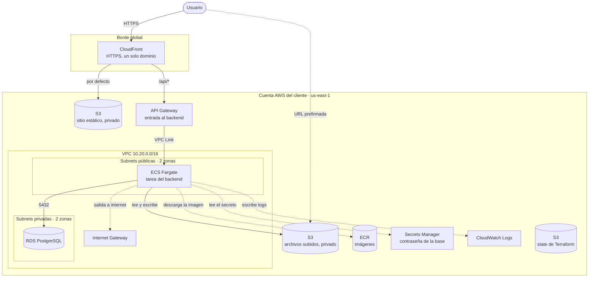

# Arquitectura

## Vista general



## La misma vista en texto

```
                          Usuario
                             │ HTTPS
                             ▼
                      ┌─────────────┐
                      │ CloudFront  │  un solo dominio
                      └──────┬──────┘
               por defecto   │   /api/*
            ┌────────────────┴────────────────┐
            ▼                                 ▼
   ┌─────────────────┐                ┌───────────────┐
   │ S3              │                │  API Gateway  │
   │ sitio estático  │                └───────┬───────┘
   │ (privado)       │                        │ VPC Link
   └─────────────────┘        ┌───────────────┼──────────────────────┐
                              │ VPC 10.20.0.0/16                     │
                              │               ▼                      │
                              │  Subnets públicas (2 zonas)          │
                              │       ┌────────────────┐             │
                              │       │  ECS Fargate   │             │
                              │       │  backend       │             │
                              │       └───────┬────────┘             │
                              │               │ 5432                 │
                              │  Subnets privadas (2 zonas)          │
                              │       ┌───────▼────────┐             │
                              │       │ RDS PostgreSQL │             │
                              │       └────────────────┘             │
                              └──────────────────────────────────────┘

   Bucket de archivos subidos (S3, privado):
   la tarea de ECS lee y escribe; el navegador sube y descarga con URL prefirmadas

   Servicios de apoyo que usa la tarea de ECS:
   ECR (imagen) · Secrets Manager (contraseña de la base) · CloudWatch Logs
   Cloud Map (registro donde API Gateway encuentra la tarea)

   Aparte: S3 con el state de Terraform (módulo bootstrap)
```

## Recorrido de una petición

1. El usuario abre el dominio de CloudFront por HTTPS.
2. CloudFront decide según la ruta:
   - `/api/*` va a API Gateway, sin caché.
   - Todo lo demás se sirve desde el bucket del sitio estático, con caché.
3. API Gateway entrega la petición a la tarea de ECS a través de un VPC Link. La encuentra por su registro en Cloud Map.
4. La tarea consulta la base de datos en RDS por el puerto 5432.

## Recorrido de un archivo subido

1. El navegador pide al backend permiso para subir un archivo.
2. El backend genera una URL prefirmada de S3, válida por pocos minutos, y la devuelve.
3. El navegador sube el archivo directo al bucket con esa URL.
4. Para descargar, el backend entrega otra URL prefirmada.

El archivo no pasa por el contenedor y el bucket nunca es público.

## Quién puede hablar con quién

| Origen | Destino | Puerto | Cómo se restringe |
|---|---|---|---|
| Internet | CloudFront | 443 | Público |
| CloudFront | S3 del sitio | 443 | Origin Access Control: el bucket solo acepta a esta distribución |
| CloudFront | API Gateway | 443 | HTTPS. El endpoint de API Gateway es público |
| API Gateway | Tarea de ECS | Puerto del contenedor | VPC Link; el security group de la tarea solo acepta al VPC Link |
| Tarea de ECS | RDS | 5432 | El security group de la base solo acepta a la tarea |
| Tarea de ECS | S3 de archivos | 443 | Solo el rol de la tarea tiene permisos sobre el bucket |
| Navegador | S3 de archivos | 443 | Solo con URL prefirmada vigente; CORS limitado al dominio del sitio |
| Internet | RDS | — | Sin acceso: subnets privadas sin ruta a internet |

## Componentes y módulo que los crea

| Componente | Función | Módulo |
|---|---|---|
| Bucket de state | Guarda el state de Terraform | `bootstrap` |
| VPC, subnets, rutas | Red del entorno | `network` |
| Bucket del sitio y CloudFront | Sirve el frontend y enruta la API | `static-site` |
| ECR | Guarda las imágenes del backend | `ecr` |
| API Gateway, VPC Link y Cloud Map | Punto de entrada estable al backend | `api-gateway` |
| Cluster, servicio y tarea | Ejecuta el backend | `ecs-service` |
| RDS PostgreSQL | Base de datos | `rds-postgres` |
| Bucket de archivos | Guarda los archivos que suben los usuarios | `uploads-bucket` |

El stack `web-app` compone todos los módulos.

## Entornos

Cada cliente tiene dos entornos, `dev` y `prod`. Cada uno es una copia completa e independiente de la arquitectura: su propia VPC, frontend, backend, base de datos y bucket de archivos. No comparten recursos, salvo el bucket de state, donde cada entorno tiene su propia ruta.

```
Cuenta AWS del cliente
├── Bucket de state
│   ├── <client>/dev/terraform.tfstate
│   └── <client>/prod/terraform.tfstate
├── Entorno dev   (VPC 10.20.0.0/16)  CloudFront · S3 sitio · API Gateway · ECS · RDS · S3 archivos
└── Entorno prod  (VPC 10.21.0.0/16)  CloudFront · S3 sitio · API Gateway · ECS · RDS · S3 archivos
```

El mismo código crea ambos: el stack `web-app` se aplica una vez por entorno, con su archivo de variables y su state. Un cambio en `dev` no puede modificar recursos de `prod`.

## Configuración mínima y configuración de producción

La arquitectura es la misma; cambian los valores del archivo de variables.

| Tema | Configuración mínima | Producción |
|---|---|---|
| Salida a internet de las tareas | IP pública en subnets públicas, sin NAT Gateway | NAT Gateway; tareas en subnets privadas |
| Tareas de ECS | 1, sin autoescalado | Varias, con autoescalado |
| Base de datos | `db.t4g.micro`, una zona | Clase mayor, Multi-AZ, protección contra borrado |
| Bucket de archivos | Sin versionado | Con versionado y protegido contra borrado |
| Dominio | Dominio de CloudFront | Dominio propio con certificado |
| Entrada al backend | API Gateway, pago por uso | API Gateway o balanceador de aplicación, según tráfico y límites |
